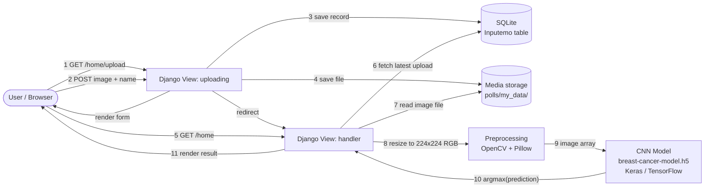
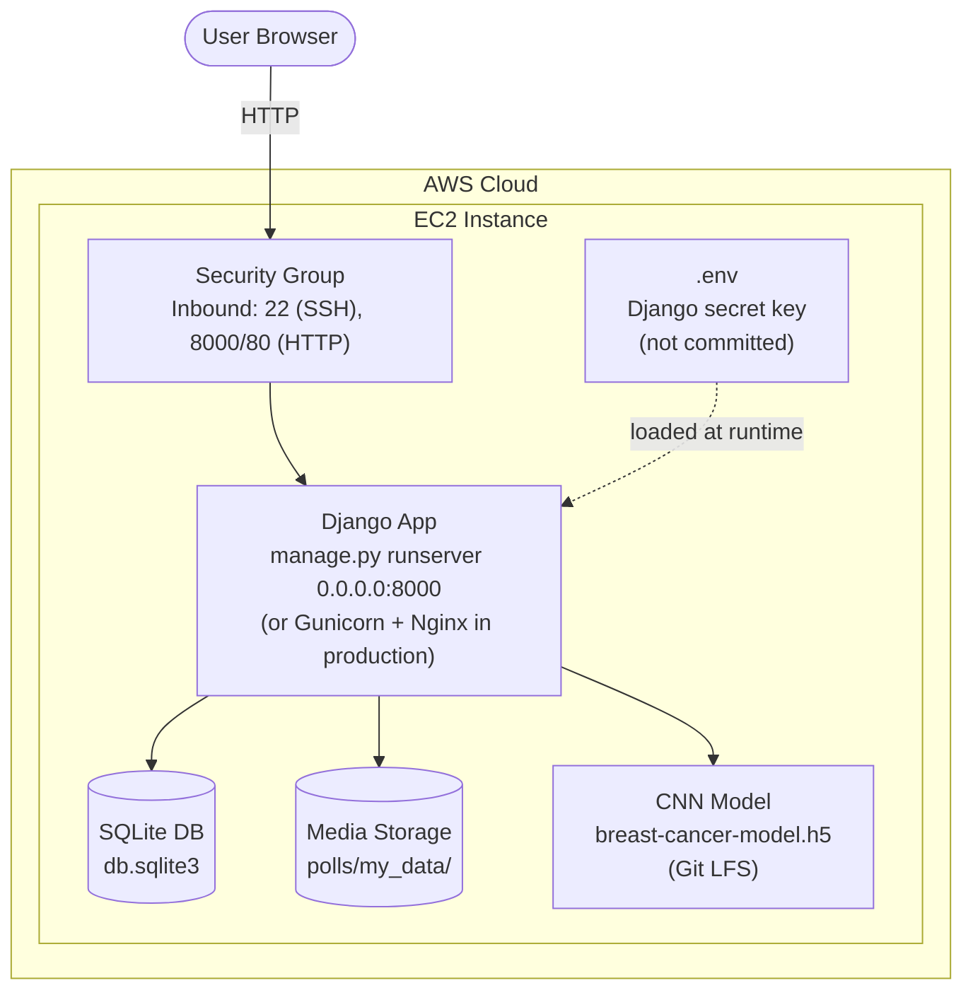

# Breast Cancer Detection — Django Web App

A Django web application that classifies breast histopathology images as **benign** or **malignant** using a Convolutional Neural Network (CNN) trained with Keras/TensorFlow. Users upload a microscope image through a web form, and the app runs it through a trained CNN to return a prediction.

## Overview

Breast cancer diagnosis from histopathology slides is traditionally done manually by pathologists. This project explores automating that first-pass classification with deep learning: a CNN is trained on labelled histopathology images (file names follow the **BreaKHis** dataset convention, e.g. `SOB_M_DC-14-2523-40-013.png` — malignant ductal carcinoma, 40x magnification), and the trained model is served through a lightweight Django front end so predictions can be requested from a browser.

The training/experimentation work lives in [`Breast Cancer.ipynb`](./Breast%20Cancer.ipynb); the deployable application lives in [`mysite/`](./mysite).

## Features

- Upload a histopathology image (`.png`) through a simple web form
- Image is preprocessed (resized to 224×224, RGB) and fed into a trained CNN
- Returns a prediction: **benign** or **malignant**
- Uploaded images and their metadata are logged to a database
- Model is cached in memory after first load, so repeat predictions don't re-read the file from disk

## Architecture

### Request flow



### Deployment architecture (AWS EC2)



> The original app runs on Django's dev server (`runserver`) directly on the EC2 instance with `DEBUG=True`. For a production-grade deployment, see [Production notes](#production-notes-and-known-limitations) below.

## Tech Stack

| Layer | Technology |
|---|---|
| Web framework | Django 3.2 |
| ML model | Keras / TensorFlow (`.h5` CNN) |
| Image processing | OpenCV (`cv2`), Pillow |
| Database | SQLite |
| Config | `python-dotenv` (`.env`) |
| Hosting | AWS EC2 |
| Large file storage | Git LFS (for the 200MB+ model file) |

## Project Structure

```
breast_cancer_django/
├── Breast Cancer.ipynb          # Model training / experimentation notebook
├── .gitattributes               # Git LFS tracking for *.h5
├── .gitignore                   # excludes .env, db.sqlite3, __pycache__, .DS_Store
└── mysite/
    ├── manage.py
    ├── mysite/                  # Django project config
    │   ├── settings.py
    │   ├── urls.py
    │   ├── wsgi.py / asgi.py
    │   └── .env                 # SECRET_KEY (not committed — see Setup)
    └── polls/                   # Django app
        ├── models.py            # Inputemo model (uploaded file + metadata)
        ├── forms.py             # EmoForm (upload form)
        ├── views.py             # handler (predict) + uploading (upload form)
        ├── sustain.py           # loads/caches image-generator-model.pkl
        ├── breast-cancer-model.h5   # trained CNN (tracked via Git LFS)
        ├── image-generator-model.pkl
        ├── migrations/
        ├── my_data/              # uploaded images land here
        └── templates/
            ├── index.html        # shows the prediction
            └── upload.html       # upload form
```

## Setup & Installation

### Prerequisites
- Python 3.8+
- Git with [Git LFS](https://git-lfs.github.com/) installed (`brew install git-lfs && git lfs install`) — required to pull the model file correctly
- `pip`

### 1. Clone the repo

```bash
git clone https://github.com/Falli007/breast_cancer_django.git
cd breast_cancer_django
```

Git LFS will automatically download `breast-cancer-model.h5` as part of the clone (as long as `git lfs install` has been run at least once on your machine).

### 2. Install dependencies

```bash
cd mysite
python -m venv venv
source venv/bin/activate        # Windows: venv\Scripts\activate
pip install django tensorflow opencv-python pillow numpy python-dotenv
```

> No `requirements.txt` is currently committed for this project — the imports above (seen in `views.py` / `settings.py`) are the runtime dependencies.

### 3. Create your `.env` file

Create `mysite/mysite/.env` (this file is gitignored and must be created locally):

```
Django_Key = "your-own-django-secret-key-here"
```

Generate a key with:
```bash
python -c "from django.core.management.utils import get_random_secret_key; print(get_random_secret_key())"
```

### 4. Run migrations and start the server

```bash
python manage.py migrate
python manage.py runserver
```

Visit `http://127.0.0.1:8000/home/upload` to upload an image, then `http://127.0.0.1:8000/home` to see the prediction.

## Usage

1. Go to `/home/upload`
2. Submit a name + a `.png` histopathology image
3. You're redirected to `/home`, which shows **benign** or **malignant** based on the model's prediction

## Model Details

- Input: RGB image resized to 224×224
- Architecture: CNN trained with Keras/TensorFlow, saved as `breast-cancer-model.h5`
- Output: 2-class softmax (benign / malignant), prediction taken via `argmax`
- Training data naming follows the BreaKHis histopathology dataset convention

## Production Notes and Known Limitations

This project was built as a learning/portfolio exercise, not hardened for production. Worth knowing if you build on top of it:

- `DEBUG = True` in `settings.py` — should be `False` in any real deployment, with `ALLOWED_HOSTS` properly restricted
- The "latest uploaded file" is tracked via a global Python variable (`var` in `views.py`) rather than session/request state — this won't behave correctly with multiple concurrent users
- Runs on Django's built-in dev server rather than Gunicorn/uWSGI behind Nginx
- SQLite is fine for a demo but not for concurrent production traffic
- The model (`.h5`, ~211MB) is loaded fresh per prediction request in `predict()` — for real traffic, this should be loaded once at startup instead

## License

No license specified — all rights reserved by default.
